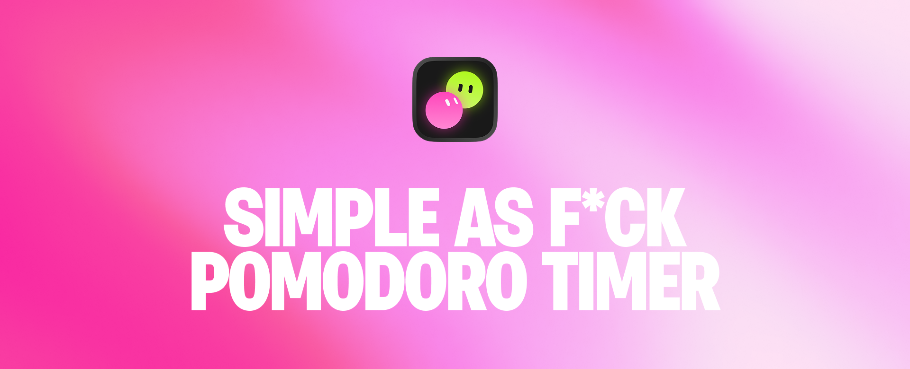
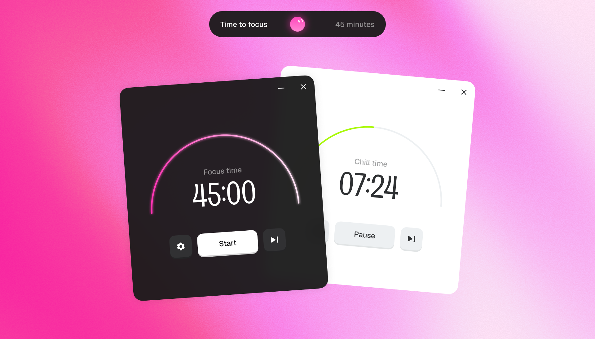

**Focuser** — simple timeboxing (pomodoro) timer for Windows.

- **Focus and chill phases.** The timer switches between them on its own and plays a sound when it's time to switch.
- **Lives in the tray.** Stays out of your way; the tray icon shows which phase you're in.
- **Custom durations.** Pick how long focus and chill last, down to the second.
